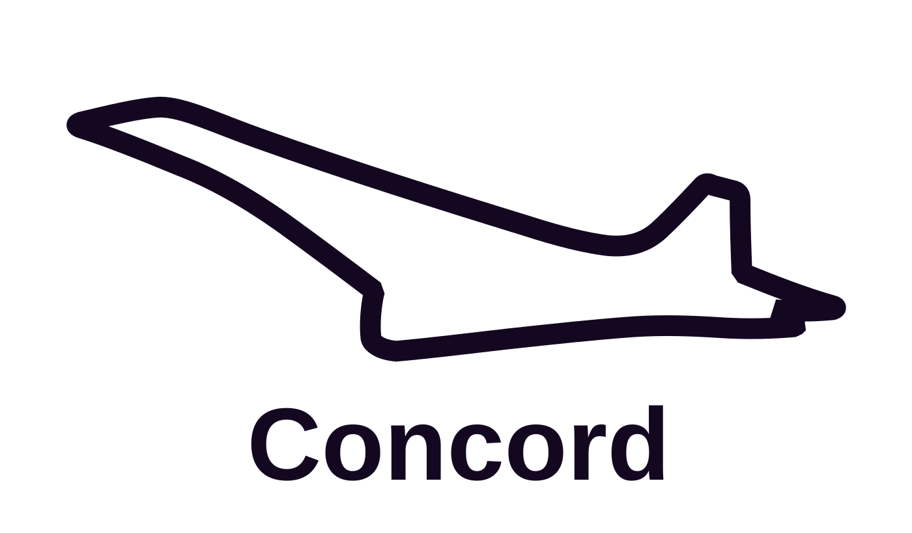
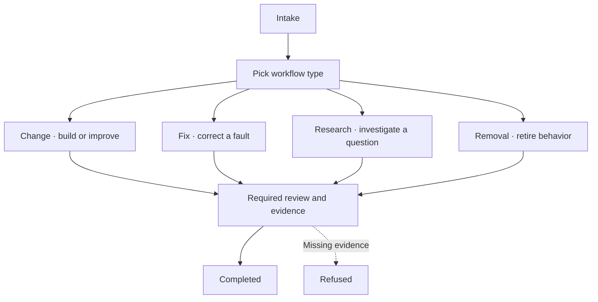
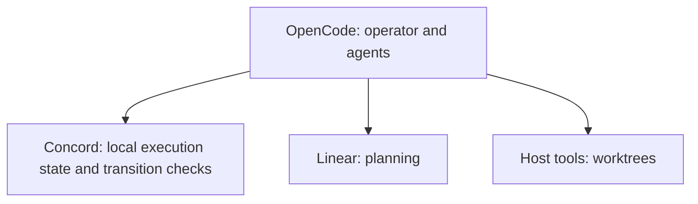

<picture>
  <source media="(prefers-color-scheme: dark)" srcset="brand/logos/concord-primary-mono-light.svg">
  
</picture>

# Concord

*Organized Product Development at Chaotic Speed.*

Concord is a local coordination engine for AI coding agents. It turns approved
goals, delegated work, and delivery evidence into a typed, durable workflow.
Operators coordinate multiple agents on one workstation; Concord checks
required conditions before recording progress and completion.

Concord models development as an evidence-gated state machine. It validates
intake, builds a typed step plan for each work item, coordinates concurrent
work across agents, and refuses completion until required review and
verification evidence are recorded. Concord enforces execution state locally.

[Why Concord](#why-concord-exists) ·
[How it works](#how-it-works) ·
[Agents and helpers](#agents-and-helpers) ·
[Architecture](#architecture) ·
[Specialized graphs](#specialized-graphs) ·
[Install](#install-and-setup) ·
[Key links](#key-links)

## Why Concord exists

Human intent starts with goals, boundaries, and trade-offs. Code deals in
concrete details: files, transactions, and exit codes. Delegating a specification
to an AI agent is an unverified cast across that gap—turning an abstract goal
into code without a runtime guard. You cannot fix an unsafe cast by shouting at
the compiler, or keep an agent on track by stuffing more rules into a prompt.

Concord supplies a structural guard outside the model's context window. Work
contracts record the agreed goals before implementation. The engine checks
required conditions before recording progress and requires recorded reviews
and verification evidence for completion.

## How it works

Intake examines the request, and the agent selects the appropriate workflow. A
work contract records the agreed scope, and work follows a plan. Required review
and evidence must be recorded before completion. The [template contract](contracts/workflow-step-templates.v1.json)
defines the exact steps for each workflow type.

Concord records review and test evidence, but it does not run tests or attest
reviewer identity. The coordinator owns the independence claim.

## Agents and helpers

Concord separates work into primary agents, specialized step helpers, and
read-only utilities so you can match the model to the job. Choose models for
demanding implementation or review and faster, lower-cost models for routine
lookups, balancing capability, speed, and cost for each role. You configure
those choices in OpenCode; Concord does not select models automatically.

| Role or helper | Workflow stage | Responsibility |
|---|---|---|
| `Concord` | End to end | Primary coordinator; drives one work item with the operator |
| `Concord-RTE` | Coordination | Optional; sequences multi-session dependencies |
| `Concord-Planner` | Planning (outside the managed workflow) | Optional; structures requirements and backlog refinement |
| `concord-research` | Diagnose (Fix) · investigate (Research) | Investigates root causes and framed research questions |
| `concord-design` | Implement (visual slices) · planning mocks | Builds UI changes, wireframes, and versioned previews; UI/UX approval stays with the operator |
| `concord-implement` | Implement | Makes one bounded change; proves a Fix regression fails before the fix and passes after |
| `concord-verify` | Inserted test-only steps | Runs named local checks or diagnoses completed CI runs without editing files |
| `concord-review` | Any reviewed step | Reviews implementation steps, research conclusions, and the final change against standards |
| `concord-explore` | Any step (read-only) | Explores repository structure and evidence paths |
| `concord-lookup` | Any step (read-only) | Researches external documentation and sources |
| `concord-advisor` | Any step (read-only) | Provides independent second opinions on bounded decisions |

The host's native Task tool owns delegation; Concord neither launches subagents
nor wraps their prompts or results. Specialized workflows and engineering
methods load on demand from the maintained [skills index](skills/README.md).

## Architecture

OpenCode hosts the operator and agents. Concord holds execution state locally
and checks which transitions are permitted. Host tools, not Concord, own
worktree creation and placement.

The trust boundary is the local workstation: the operating system user account,
the OpenCode process, and the OpenCode adapter. Concord does not defend against arbitrary
code already running under that account. See the [architecture reference](.concord/docs/core-architecture.md).

## Specialized graphs

Concord uses separate graphs for distinct parts of the work:

1. **Coordination.** Relations record dependencies between work items and help
   identify ready work. For two approved Product-changing contracts, an overlap
   resolution can record sequencing through dependency edges.
2. **A work item's plan.** Each work item has a step plan that can grow with
   diagnostic or follow-up steps as work proceeds.
3. **Product law and Domains.** Domains partition Product law by areas of
   responsibility. Each law has one home Domain, and relations describe
   connections between Domains and between laws.
4. **Evidence.** Bindings link results and review records to the work and its
   version, so completion is judged from recorded evidence rather than an agent
   saying it is done. Collecting evidence is separate from accepting it.

## Install and setup

Concord targets Linux amd64 and requires Python 3 for installation.

- Download the [latest release](https://github.com/Sharper-Flow/concord/releases/latest).
- Follow the [installation guide](.concord/docs/installation.md).
- Set up your client and repository using the [OpenCode setup guide](adapter/opencode/README.md#operator-bootstrap-cli).

> **Headless servers:** Without an existing desktop login collection, the installer
> initializes an unencrypted, user-scoped keyring collection protected by
> operating-system file permissions.

## Key links

- [Product vision](.concord/docs/product-vision.md)
- [Product law](.concord/law/)
- [Architecture reference](.concord/docs/core-architecture.md)
- [Documentation index](.concord/docs/README.md)
- [OpenCode adapter guide](adapter/opencode/README.md)
- [Contribution guidance](CONTRIBUTING.md)

## Contributing

Read [CONTRIBUTING.md](CONTRIBUTING.md) before opening a pull request.

## Security

Report suspected vulnerabilities privately through GitHub Security Advisories,
not a public issue or pull request. Only the latest tagged release is supported
for security fixes. See [SECURITY.md](SECURITY.md).

## License

Concord is released under the [MIT License](LICENSE).
