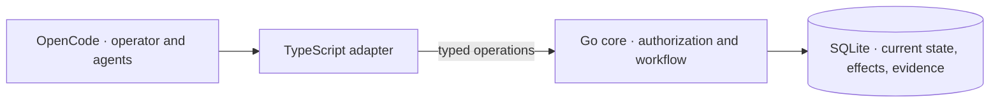

<picture>
  <source media="(prefers-color-scheme: dark)" srcset="brand/logos/concord-primary-mono-light.svg">
  
</picture>

# Concord

*Organized Product Development at Chaotic Speed.*

Concord is a local coordination engine for AI coding agents. It turns approved
goals, delegated work, and delivery evidence into a typed, durable workflow.
One operator coordinates multiple agents on one workstation; the engine gates
every state transition on verified evidence.

[Why Concord](#why-concord-exists) ·
[Completion example](#completion-in-practice) ·
[Engineering highlights](#engineering-highlights) ·
[Architecture](#architecture-and-tradeoffs) ·
[Skills & methods](#portable-skills-and-methods) ·
[Install](#install-a-release)

## Why Concord exists

When agents make independent changes across related parts of a project, each
change can pass review in isolation while their combined effect breaks an
approved requirement. Concord records approved goals and enforces workflow
conditions that govern managed execution.

- **Completion requires evidence.** Completion requests refuse until the
  evidence types required by the contract and workflow are durably bound. An
  agent's claim that work is finished cannot substitute for verified evidence.
- **Goals are fixed before work begins.** The operator approves outcome
  predicates first. At acceptance, Concord measures the delivered result
  against those predicates rather than against an agent's summary.
  ([CD-0012](.concord/docs/decisions/CD-0012-bind-stated-goals-to-delivered-outcomes.md))
- **Domains own code roots exclusively.** Architectures partition into Domains
  that own distinct code roots and maintain typed architectural facts.
  Concurrent execution refuses conflicting architectural writes—such as
  overlapping law changes, domain boundary shifts, or relation mutations—while
  permitting parallel work across independent domains.
  ([CD-0244](.concord/docs/decisions/CD-0244-domains-own-code-exclusively-and-hold-typed-facts.md),
  [Architecture and overlap rules](.concord/docs/decisions/CD-0222-architecture-bound-product-law-with-package-boundary-code-ownership.md#d6-architectural-overlap-is-explicit-before-concurrent-work-proceeds))
- **Every refusal names its remedy.** Refusals are strictly typed and state
  which condition failed, directing a blocked agent to the corrective path
  rather than leaving it to guess.

This carries a real cost. An agent must earn each transition, and a session that
skips a step is refused rather than obeyed.

## Completion in practice

An agent's request to finish is not permission to finish. The
[terminal-gate integration test](internal/agent/trunk_firewall_test.go#L116-L174)
exercises two synthetic cases for an approval-gated terminal operation through
the agent dispatcher:

| Request | Engine result |
|---|---|
| Complete work without evidence | Refuse with `missing_evidence`. |
| Complete work with evidence | Require approval, then complete after a valid signed approval. |

This is a summary of the test cases, not a CLI transcript or a promise that
evidence alone satisfies every workflow. Required evidence and other completion
conditions come from the approved contract and workflow.

Run the example from a source checkout:

```sh
bin/oc-test targeted -- go test ./internal/agent \
  -run '^TestMainCheckoutLifecyclePreservesTerminalGates$' -count=1 -v
```

## Engineering highlights

### Authority enforced outside the prompt

Registered-client policies restrict operations by capability, Product, Project,
and agent scope. Worker reports require Ed25519 signatures bound to the specific
attempt; timestamp and nonce checks reject expired or replayed assertions.
Authenticating a worker report does not grant that worker permission to accept
its own result.

Inspect the [authorization checks](internal/agent/authority.go),
[signed-evidence validation](internal/agent/worker_evidence.go), and
[authority refusal tests](internal/agent/authority_refusal_kind_test.go).

### Current-state authority and explicit durability

SQLite holds current execution state and unresolved-effect receipts, not
historical event logs ([CD-0242](.concord/docs/decisions/CD-0242-knowledge-first-workflows-keep-current-state-not-history.md)).
The store uses `synchronous=FULL` for designated durable transactions, then restores
`synchronous=NORMAL` for ordinary writes. Pinned readers never block durable
commits, and low-level SQLite mechanics run in an isolated internal subsystem.
The distinction makes durability costs explicit rather than claiming that every
write carries the same crash guarantee.

Inspect the [transaction owner](internal/store/durable.go) and
[durability tests](internal/store/durable_test.go). The separate
[ten-process conformance harness](internal/store/conformance_test.go) exercises
concurrent access to the local store.

### Domain Shape v1 and architectural facts

Products declare explicit package roles (`domain`, `mixed`, `composition`,
`test_support`) and maintain typed architectural facts under
[CD-0244](.concord/docs/decisions/CD-0244-domains-own-code-exclusively-and-hold-typed-facts.md).
Boundary checks validate import edges against declared `depends_on`
dependencies, while an enforceable ratchet prevents architectural drift.
Inspect the [domain read engine](internal/store/domain_reads.go).

### Recoverable installation and automated releases

The release workflow builds Linux amd64 artifacts, generates an SPDX software
bill of materials, checksums every uploaded asset, and attests build provenance.
The installer journals changes and recovers interrupted operations without
overwriting files the operator changed after the transaction began.

The [installer tests](scripts/test-installer.py#L2408-L2467) inject process death
at each transaction phase during install, upgrade, and uninstall. The
[release workflow](.github/workflows/release.yml) owns publication.

## Portable skills and methods

Concord ships on-demand skills directly with each release
([CD-0245](.concord/docs/decisions/CD-0245-concord-ships-the-skill-that-operates-its-domain-shape.md),
[CD-0246](.concord/docs/decisions/CD-0246-concord-ships-portable-engineering-methods.md)).
The installer registers them with OpenCode without imposing runtime overhead or
altering worker obligations:

- **`concord-domain-shape-stewardship`**: Initialize, migrate, refine, and audit
  Product Domain boundaries and typed architectural facts.
- **`concord-law-writing`**: Draft, amend, or prune Product law held by Concord
  without weakening obligations or shifting approval boundaries.
- **Engineering methods**: Portable skills for `concord-diagnosis`,
  `concord-codebase-design`, `concord-work-shaping`, and `concord-retrospective`.
  Worker lane definitions carry lane-specific guidance directly, so execution
  integrity never depends on loading an optional skill.
- **Total engineering cost dependency selection**: Guidance instructs agents to
  evaluate dependencies by total engineering cost rather than minimizing
  dependency counts, choosing established, maintained libraries when clearer and
  more reliable.

## Architecture and tradeoffs



- **One core owns the rules.** Go owns domain logic and workflow admission. The
  TypeScript adapter handles host context, credentials, and transport rather
  than maintaining a second implementation of those rules.
- **Local authority, not a distributed service.** One SQLite database keeps
  approved requirements, execution state, evidence, knowledge, and research
  together. The design targets one operator's workstation, not a multi-host service.
- **Planning stays separate from execution.** Agents use the Linear MCP server
  for planning. Concord retains at most one recorded issue identity per work
  unit; the binary makes no Linear API call and holds no Linear credential.

The security boundary trusts the OS account, OpenCode process, installed adapter,
and credential service. It does not isolate arbitrary code that already controls
that account. See the [transport contract](.concord/docs/agent-adapter-transport-contract.md#21-client-registration-and-key-storage),
[core architecture](.concord/docs/core-architecture.md), and
[managed development authority](.concord/docs/managed-development-authority.md).

### Graph usage

Concord uses several distinct graphs, not one universal directed acyclic graph
(DAG). Each mechanism gives its edges a different meaning:

- **Work relations describe coordination.** The typed
  [relation vocabulary](contracts/relation-vocabulary.v1.json) defines stored
  relations and inverse query labels, such as `blocks` and `blocked_by`.
  For actionable work, `blocks` excludes the target from the
  [ready queue](internal/store/query.go) while the source is `needed` or
  `in_progress`; `depends_on` records a requirement whose transitive closure can
  be read. Neither refuses a lifecycle start by itself. A resolved
  [Domain overlap](internal/store/workflow_domain_overlap.go) can sequence
  execution entry through either kind.
- **Workflow edges govern execution.** A definition connects workflow steps,
  with cycle checks that exclude declared retry and failure edges. Recovery is
  explicit, not an assumption that execution only moves forward. Inspect the
  [graph validator](internal/store/workflow_registry.go) and
  [correction and premise-recovery routes](internal/store/workflow_recovery_routes.go).
- **Worker-job prerequisites pin exact work.** Within a work item, prerequisites
  name a job and revision, optionally an exact accepted result reference.
  [Readiness checks](internal/store/worker_jobs.go) require those prerequisites
  to be satisfied and check the candidate job's latest revision, active contract,
  readiness evidence, and unresolved references. These are not work-to-work
  `depends_on` edges.
- **Law and Domain relations describe authority and architecture.** Law links
  express refinement, subordination, supersession, or conflict; federated law
  identities include their home Project so equal local IDs stay distinct.
  Domain relations separately express dependency, shared contracts, or
  replacement. Inspect the [knowledge model](internal/store/knowledge_manifest.go)
  and [federated law validation](internal/store/product_knowledge_source.go).
- **Evidence links record provenance, not acceptance.** An
  [evidence binding](internal/store/workflow.go) records an immutable subject
  separately from the producer, run, and watermark. That identifies what was
  observed and who produced the evidence; it does not itself accept a worker
  result or establish that an approved outcome was met. Verdicts and completion
  have their own gates.

## Build and verify from source

Source development uses the Go toolchain pinned in [`go.mod`](go.mod). Adapter
tests also need Bun. Run these commands from the repository root to inspect the
CLI. Choose checks using the [local verification guide](TESTING.md)
before running a suite. Whole-package and whole-adapter runs require broad admission:

```sh
go run ./cmd/concord --version
bin/oc-test broad -- go test ./cmd/concord
bin/oc-test broad -- env -u CONCORD_SELECTED_PRODUCT_ID bun test adapter/opencode/
```

For documentation changes, check relative links and public content:

```sh
bin/oc-test targeted -- python3 scripts/check-doc-links.py
bin/oc-test targeted -- python3 scripts/check-public-content.py
```

The local smoke tier runs adapter tests, JSON/law validation, and the Go
packages CI tests without shards. It leaves out `internal/store` and
`cmd/concord`, which CI splits into shard jobs. The conformance tier runs the
ten-process SQLite harness:

```sh
bin/oc-test smoke
bin/oc-test conformance
```

To test one shard of a package that smoke leaves out, run CI's selection for
it, here shard 1 of the 7 `internal/store` shards:

```sh
bin/oc-test broad -- bash -euo pipefail -c 'go test -timeout=15m -run "$(python3 scripts/go-test-shard.py ./internal/store 1 7)" ./internal/store'
```

Every tier sets a kernel-enforced 1024 MiB limit on each file a test writes.
A writer that reaches it is normally killed by SIGXFSZ, and the tier reports
its command's exit status. See [`bin/oc-test`](bin/oc-test) for
the limit's per-run override, workload, and host admission details, and the
[CI workflow](.github/workflows/ci.yml) for the required repository checks.
Heavy tiers refuse to start without the host gate. `PASS` reports process exit,
not proof that a named test matched. `bin/oc-test plan targeted -- <command>`
shows admission and explicit selection without running tests or discovery.

## Roadmap

Development directions extend the same authority and evidence model without
compromising local verification:

- **Release compatibility.** Expand release gates to exercise snapshot restoration
  across earlier released binaries and candidate releases.
- **Domain Shape migration tooling.** Deepen automated boundary validation and
  migration workflows across mixed multi-domain codebases.

## Install a release

Concord supports Linux amd64. Read the [full prerequisites](.concord/docs/installation.md#prerequisites)
before you install. Run the installer with Python 3.

Before an upgrade introduces the `Concord`, `Concord-RTE`, or optional
`Concord-Planner` profiles, complete
the [primary-agent authorization step](adapter/opencode/README.md#authorize-the-primary-agent-names-before-activation)
for every affected trusted client. Installation does not grant agent scope;
verify the exact names before activation or selecting the profiles.

> **Warning:** On a headless host without a login collection, the installer
> creates an unencrypted, user-scoped keyring collection. The operating-system
> user boundary restricts access, but it does not encrypt the collection.

Download `concord-installer.py` from the
[latest release](https://github.com/Sharper-Flow/concord/releases/latest), then
install that release's tag (replace `vX.Y.Z`):

```sh
python3 concord-installer.py install --version vX.Y.Z
```

The installer verifies the published checksum and bundle before it changes the
operator environment. It does not overwrite user-authored files and recovers
an interrupted operation cleanly. Restart OpenCode after installation.

The [installation guide](.concord/docs/installation.md) covers artifact verification,
managed paths, repair, upgrade, uninstall, and first-use requirements.

<details>
<summary>Upgrade note: retirement of the planning mirror</summary>

### Planning retirement upgrade

`concord upgrade` writes a verified snapshot of the unmigrated store to the
data root's `backups` directory before any breaking migration applies, and
names it in its report as `backup`. Migration 124 dropped unsent
planning-mirror writes, Initiative projections, Linear Project links, and the
Product planning-mode column. It retained recorded issue identities only when
both the issue key and URL were non-empty; incomplete links remain only in the
backup. Use the backup for any reconciliation through the Linear MCP server.

</details>

## First use

Complete the [operator bootstrap](adapter/opencode/README.md#operator-bootstrap-cli)
before you use adapter tools:

1. Register the client.
2. Create the Product and its first Project.
3. Add a locator for the Project's Git repository.

Concord does not invent these records or their keys. The bootstrap commands
listed in the adapter guide read one strict JSON object from stdin and write one
bounded JSON result.

```sh
concord --version
concord --help
```

You start each session with your host tooling. Inside a session, agents enter
managed work through the adapter's `concord_work_start` tool.

## Learn more

- [Installation guide](.concord/docs/installation.md)
- [OpenCode adapter guide](adapter/opencode/README.md)
- [Managed development authority](.concord/docs/managed-development-authority.md)
- [Documentation index](.concord/docs/README.md)

## Contributing

Read [CONTRIBUTING.md](CONTRIBUTING.md) before opening a pull request.

## Security

Report suspected vulnerabilities privately through GitHub Security Advisories,
not a public issue or pull request. Only the latest tagged release is supported
for security fixes. See [SECURITY.md](SECURITY.md).

## License

Concord is released under the [MIT License](LICENSE).
