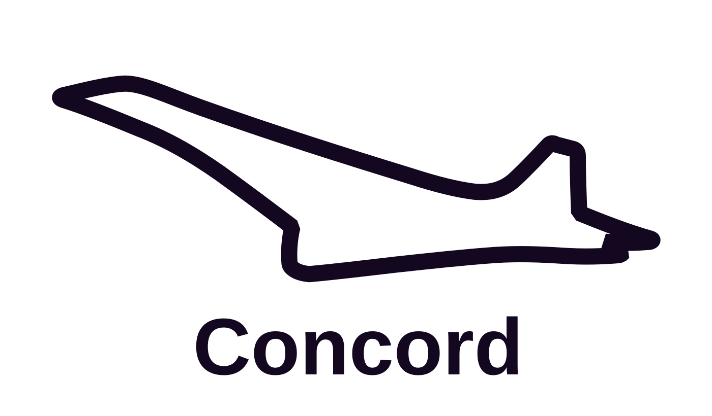
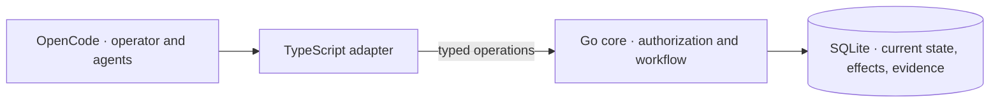

<picture>
  <source media="(prefers-color-scheme: dark)" srcset="brand/logos/concord-primary-mono-light.svg">
  
</picture>

# Concord

*Organized Product Development at Chaotic Speed.*

Concord is a local coordination engine for AI coding agents. It turns approved
goals, delegated work, and delivery evidence into a typed, durable workflow.
One operator coordinates multiple agents on one workstation; the engine gates
every state transition on verified evidence.

[Why Concord](#why-concord-exists) ·
[Workflow](#workflow) ·
[Engineering highlights](#engineering-highlights) ·
[Batteries included](#batteries-included) ·
[Architecture](#architecture-and-tradeoffs) ·
[Install](#install-and-setup)

## Why Concord exists

Human intent is typed at the highest level of abstraction: goals, architectural
boundaries, and product invariants. Machine code, by contrast, operates at the
lowest: byte offsets, transaction boundaries, and exit codes.

Delegating a specification to an AI agent is an unverified downcast across that
semantic gap. In traditional programming, casting from an abstract interface to
a concrete type without a runtime guard invites undefined behavior and crashes.
You cannot fix an unsafe cast by shouting at the compiler, and you cannot fix an
agent's semantic drift by stuffing more instructions into a prompt.

Concord supplies the structural runtime guard. It enforces workflow conditions,
outcome predicates, and evidence bindings outside the model's context
window before state transitions commit:

- **Completion requires evidence.** Concord refuses completion requests until
  the required evidence types are durably bound. An agent's claim that work is
  finished cannot substitute for verified evidence.
- **Goals are fixed before work begins.** The operator approves outcome
  predicates first. At acceptance, Concord measures the delivered result
  against those predicates rather than against an agent's summary.
- **Domains own code roots exclusively.** Codebases partition into Domains that
  own distinct code roots and hold typed architectural facts. Concurrent
  execution blocks conflicting writes—such as overlapping policy edits, domain
  boundary shifts, or relation changes—while allowing parallel work across
  independent domains.
- **Every refusal names its remedy.** Refusals are strictly typed and state
  which condition failed, directing a blocked agent to the corrective path
  rather than leaving it to guess.

## Workflow

Concord models software development as a state machine. Instead of asking an
agent if it finished, the engine advances a task only when verified evidence
satisfies the transition conditions.

### Why: prompts cannot enforce boundaries

AI coding agents drift. Left on their own, they hallucinate completion, wander
outside their assigned scope, and approve their own broken code. Prompts are soft
suggestions that models can ignore under context pressure. Reliable multi-agent
coordination requires mechanical gates enforced outside the context window.

### How: the evidence-gated lifecycle

Every change progresses through five deterministic enforcement stages:

1. **Lock the goal before work starts.**
   - *Why*: Prevents agents from moving the goalposts when tasks get difficult.
   - *How*: The operator approves *outcome predicates* upfront—exact assertions
     like passing test locators, schema outputs, or file states. Concord checks
     completion against these predicates, never against an agent's summary.
2. **Isolate execution in dedicated worktrees.**
   - *Why*: Prevents changes from bleeding across packages or breaking trunk.
   - *How*: Concord boots each task in an isolated Git worktree pinned to an
     approved path scope. Operations outside the assigned paths are refused.
3. **Record verification evidence.**
   - *Why*: Review needs test results for the same commit it judges.
   - *How*: The coordinator binds an attributed local or required CI report with
     its source, commit, result and run reference. Concord compares recorded
     commits; independent review judges adequacy. Concord does not run the tests.
4. **Require independent review.**
   - *Why*: The author must not approve their own work.
   - *How*: The coordinator obtains independent review through the host's native
     Task tool and records its typed outcome against the current candidate.
     Concord checks the recorded subject and findings, not which subagent
     produced the review. The coordinator owns that independence claim.
5. **Gate terminal transitions on recorded evidence.**
   - *Why*: Keeps completion tied to recorded evidence for the reviewed commit.
   - *How*: When an agent requests a `completed` transition, Concord validates
     every required evidence binding and refuses the transition with
     `missing_evidence` until the bindings stand.

### Verification in practice

The [terminal-gate integration test](internal/agent/trunk_firewall_test.go#L116-L174)
demonstrates this gate directly:

| Scenario | Agent action | Engine verdict |
|---|---|---|
| **Missing evidence** | Agent requests completion with no attached evidence | Refuses with `missing_evidence`. Prompt claims cannot satisfy the transition. |
| **Gated completion** | Agent submits valid verification evidence | The transition completes: the recorded evidence satisfies the terminal gate. |

Run this test from a source checkout:

```sh
bin/oc-test targeted -- go test ./internal/agent \
  -run '^TestMainCheckoutLifecyclePreservesTerminalGates$' -count=1 -v
```

## Engineering highlights

### Authority enforced outside the prompt

Registered-client policies restrict operations by capability, Product, Project,
and agent scope. Workflow gates check current subjects, evidence, and approval
boundaries. Native Task execution remains host-owned; Concord does not attest
which subagent produced a recorded review.

Inspect the [authorization checks](internal/agent/authority.go) and
[authority refusal tests](internal/agent/authority_refusal_kind_test.go).

### Current-state authority and explicit durability

SQLite holds current execution state and unresolved-effect receipts rather than
replaying historical event logs. The store uses `synchronous=FULL` for designated
durable transactions and `synchronous=NORMAL` for ordinary writes. Pinned readers
never block durable commits, and low-level SQLite mechanics run in an isolated
internal subsystem. This makes durability costs explicit instead of assuming every
write needs the same disk-flush guarantees.

Inspect the [transaction owner](internal/store/durable.go) and
[durability tests](internal/store/durable_test.go). The separate
[ten-process conformance harness](internal/store/conformance_test.go) exercises
concurrent access to the local store.

### Recoverable installation and automated releases

The release workflow builds Linux amd64 binaries, generates an SPDX software
bill of materials, checksums each asset, and attests build provenance. The
installer journals file operations so interrupted transactions recover cleanly
without overwriting operator edits.

The [installer tests](scripts/test-installer.py#L2408-L2467) test process death
across every transaction phase during install, upgrade, and uninstall. The
[release workflow](.github/workflows/release.yml) automates publication.

## Batteries included

Concord ships with primary agent profiles, native step helpers, read-only utilities, and
portable skills ready for OpenCode out of the box.

### Agent profiles and utilities

- **Primary roles**: `Concord` coordinates work with the operator; `Concord-RTE`
  sequences multi-session dependencies; `Concord-Planner` structures requirements
  and planning intake.
- **Read-only utilities**: `concord-explore` analyzes repository structure;
  `concord-lookup` investigates external sources; `concord-advisor` provides
  independent second opinions on bounded problems.
- **Native review helper**: `concord-review` loads the [review method](skills/concord-review/SKILL.md),
  repairs in-scope findings and leaves changes uncommitted for the caller.
- **Native test-only helper**: `concord-verify` runs named local checks or diagnoses
  completed CI, returning commands, exits and failure evidence without editing
  files or waiting on CI.
- **Native implementation helper**: `concord-implement` makes one bounded change,
  proves a Fix regression fails before the fix and passes after, and returns
  uncommitted changes and check results to the caller.
- **Native research helper**: `concord-research` investigates a framed question
  across repository and external sources within the caller's budget, returning
  cited findings, uncertainty and gaps without editing files.
- **Native design helper**: `concord-design` makes a bounded visual UI or UX change
  in assigned files and returns uncommitted changes, checks and a versioned preview
  URL or screenshots. UI/UX approval stays with the operator; Product browser
  tooling is optional and host-provided.

The host's native Task tool owns delegation. Concord neither launches subagents
nor wraps their prompts or results.

### Portable skills and methods

The installer registers on-demand skills in OpenCode without adding runtime
overhead:

- **`concord-law-writing`**: Draft, amend, or prune Product specifications and
  decisions without altering obligations or approval boundaries.
- **Engineering methods**: Portable skills for diagnosis, codebase design,
  work shaping, instruction writing, and retrospectives.
- **Dependency selection by total cost**: Evaluates dependencies by total
  engineering cost rather than minimizing dependency counts, favoring
  established libraries over bespoke reinvention.

## Architecture and tradeoffs



Concord separates responsibilities across three focused layers:

- **Single core for domain authority.**
  - *What*: Go implements all workflow rules, admission logic, and state transitions.
  - *Why*: Prevents dual-maintenance bugs and rule drift between host plugins and the engine.
  - *How*: The TypeScript adapter acts as a thin transport layer for host context, process credentials, and OpenCode tools, proxying typed operations directly to the Go binary.
- **Local workstation database.**
  - *What*: A single SQLite database stores requirements, current execution state, evidence, and research.
  - *Why*: Eliminates remote network latency and multi-tenant synchronization overhead during high-cadence local agent development.
  - *How*: The store runs SQLite in WAL mode with `synchronous=NORMAL`, and switches a designated durable transaction to `synchronous=FULL`.
- **Decoupled planning and execution.**
  - *What*: Linear handles planning; Concord coordinates local execution.
  - *Why*: Keeps external tracker state from polluting local runtime invariants while allowing operators to manage milestones in their tool of choice.
  - *How*: Agents read and write Linear through the Linear MCP server. Concord records at most one issue key and URL per work item; the binary makes no Linear API call and holds no Linear credential.

The trust boundary is the local workstation: the operating system user account, the OpenCode process, and the adapter. Concord does not defend against arbitrary code already running under that account. See the [transport contract](.concord/law/specs/agent-adapter-transport-contract.md), [core architecture](.concord/docs/core-architecture.md), and [managed development authority](.concord/law/specs/managed-development-authority.md).

### Specialized graphs over monolithic DAGs

Complex agent workflows cannot fit into a single directed acyclic graph (DAG) without conflating scheduling, execution recovery, and architectural authority. Concord isolates four specialized graphs:

1. **Task coordination graph (`blocks`, `depends_on`)**
   - *Why*: Manages inter-task dependencies and parallel execution queues.
   - *How*: Directed relations from the [relation vocabulary](contracts/relation-vocabulary.v1.json) filter tasks from the [ready queue](internal/store/query.go). When concurrent tasks touch the same Domain, the later agent merges the earlier change and an [overlap resolution](internal/store/workflow_domain_overlap.go) can record their order.
2. **State execution graph (Workflow state machines)**
   - *Why*: Real engineering requires retries, rollbacks, and recovery paths that break strict DAG acyclicity.
   - *How*: Workflow definitions link execution stages through directed graphs with explicit cycle validation for approved retry and premise-recovery routes. Inspect the [graph validator](internal/store/workflow_registry.go) and [recovery routes](internal/store/workflow_recovery_routes.go).
3. **Architectural authority graph (Domains and specifications)**
   - *Why*: Tracks how specifications and codebases relate across multi-repository projects.
   - *How*: Law relations model refinement, supersession, and conflict across specifications. Domain relations declare boundary dependencies, shared contracts, and replacements. Inspect the [committed law-folder snapshot](internal/store/law_snapshot.go) and [law validation](internal/store/law_boundary.go).
4. **Provenance graph (Evidence bindings)**
   - *Why*: Records who produced what without prematurely declaring work accepted.
   - *How*: [Evidence bindings](internal/store/workflow.go) tie immutable artifacts to specific producers, run timestamps, and watermark digests. Gathering evidence and evaluating acceptance remain decoupled operations.

## Build and verify from source

Building Concord requires the Go toolchain pinned in [`go.mod`](go.mod). Testing the adapter also requires Bun.

Local verification runs through the [`bin/oc-test`](bin/oc-test) test runner, which tiers workloads to give fast feedback without overloading the workstation. See [`TESTING.md`](TESTING.md) for suite selection details.

### Quick checks and documentation audit

Verify the CLI build and validate documentation links and public content boundaries:

```sh
go run ./cmd/concord --version
bin/oc-test targeted -- python3 scripts/check-doc-links.py
bin/oc-test targeted -- python3 scripts/check-public-content.py
```

### Full package and adapter suites

Whole-package Go runs and full adapter test suites require broad workload admission:

```sh
bin/oc-test broad -- go test ./cmd/concord
bin/oc-test broad -- env -u CONCORD_SELECTED_PRODUCT_ID bun test adapter/opencode/
```

### Tiered test suites

- **Smoke tier (`bin/oc-test smoke`)**: Runs adapter tests, JSON schema validators, and unsharded Go package tests. It omits `cmd/concord`, `internal/agent`, and `internal/store`, which CI splits into shard jobs.
- **Conformance tier (`bin/oc-test conformance`)**: Runs the ten-process SQLite harness to verify concurrency and transaction-locking invariants.
- **Deterministic store sharding**: To test heavy packages locally without running the entire suite, run individual CI shards. For example, to run shard 1 of the 7 `internal/store` shards:

```sh
bin/oc-test broad -- bash -euo pipefail -c 'go test -timeout=15m -run "$(python3 scripts/go-test-shard.py ./internal/store 1 7)" ./internal/store'
```

Heavy tiers refuse to start without the host test gate. Every tier caps each file a test writes at 1024 MiB; a writer that reaches the cap is normally killed by SIGXFSZ. `PASS` reports the command's exit status, not proof that a named test matched. To see admission and selection without running tests, use `bin/oc-test plan targeted -- <command>`. [`bin/oc-test`](bin/oc-test) documents the per-run override and host admission; the [CI workflow](.github/workflows/ci.yml) defines the required repository checks.

## Roadmap

Development directions extend the same authority and evidence model without
compromising local verification:

- **Release compatibility.** Expand release gates to exercise snapshot restoration
  across earlier released binaries and candidate releases.

## Install and setup

Concord targets Linux amd64 and requires Python 3 for installation. Review the
[installation prerequisites](.concord/docs/installation.md#prerequisites) before
beginning.

### 1. Download and run the installer

Download `concord-installer.py` from the
[latest release](https://github.com/Sharper-Flow/concord/releases/latest) and
install the target release tag (replace `vX.Y.Z`):

```sh
python3 concord-installer.py install --version vX.Y.Z
```

The installer verifies the release checksum and archive before changing any
data, binary, adapter, or OpenCode configuration path. It journals file
operations to recover from interrupted installs and never overwrites
user-modified files. Release assets also carry GitHub build-provenance
attestations, which the installer does not check.
Restart OpenCode after installation completes.

> **Keyring notice for headless servers:** On a headless system without an
> existing desktop login collection, the installer initializes an unencrypted,
> user-scoped keyring collection protected by operating-system file permissions.

### 2. Authorize agent profiles

Before activating agent profiles (`Concord`, `Concord-RTE`, or optional
`Concord-Planner`), [authorize the primary agent names](adapter/opencode/README.md#authorize-the-primary-agent-names-before-activation)
on each trusted client. Installing profiles does not grant agent execution
scope.

### 3. Bootstrap your project

Initialize the repository using the [operator bootstrap CLI](adapter/opencode/README.md#operator-bootstrap-cli):

1. **Register the client** (`concord client-register`): records the client's Ed25519 public key and its capability and scope grants. The private key stays in the host credential service.
2. **Create the Product and Project** (`concord product-create`): establishes the coordination scope.
3. **Add a repository locator** (`concord project-locator-add`): binds the Project to a checkout path or Git remote.

Each bootstrap command reads a strict JSON payload from stdin and writes a
bounded JSON response to stdout:

```sh
concord --version
concord --help
```

Once bootstrapped, launch agent sessions through your host environment.
[Host tools own branch and worktree placement](.concord/law/decisions/CD-0088-host-owned-work-bootstrap-preserves-pre-readiness-authority.md#d1-host-tools-own-worktree-isolation).
Inside a session, use the published capture and workflow operations for Concord
state. Session preparation and continuity retain their identity and state checks;
host placement grants no workflow authority.

The [installation guide](.concord/docs/installation.md) covers artifact
verification, managed paths, repair, upgrade, and uninstall.

<details>
<summary>Upgrade note: retirement of the planning mirror</summary>

### Planning retirement upgrade

`concord upgrade` writes a verified snapshot of the unmigrated store to the
data root's `backups` directory before any breaking migration applies, and
names it in its report as `backup`. Migration 124 dropped unsent
planning-mirror writes, Initiative projections, Linear Project links, and the
Product planning-mode column. It kept a recorded issue identity only when both
its issue key and URL were non-empty. Use the backup for any reconciliation
through the Linear MCP server.

</details>

## Learn more

- [Installation guide](.concord/docs/installation.md)
- [OpenCode adapter guide](adapter/opencode/README.md)
- [Managed development authority](.concord/law/specs/managed-development-authority.md)
- [Documentation index](.concord/docs/README.md)

## Contributing

Read [CONTRIBUTING.md](CONTRIBUTING.md) before opening a pull request.

## Security

Report suspected vulnerabilities privately through GitHub Security Advisories,
not a public issue or pull request. Only the latest tagged release is supported
for security fixes. See [SECURITY.md](SECURITY.md).

## License

Concord is released under the [MIT License](LICENSE).
