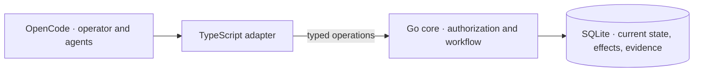

<picture>
  <source media="(prefers-color-scheme: dark)" srcset="brand/logos/concord-primary-mono-light.svg">
  
</picture>

# Concord

*Organized Product Development at Chaotic Speed.*

Concord is a local coordination engine for AI coding agents. It turns approved
goals, delegated work, and delivery evidence into a typed, durable workflow.
One operator coordinates multiple agents on one workstation; the engine gates
every state transition on verified evidence.

[Why Concord](#why-concord-exists) ·
[Workflow](#workflow) ·
[Engineering highlights](#engineering-highlights) ·
[Batteries included](#batteries-included) ·
[Architecture](#architecture-and-tradeoffs) ·
[Install](#install-a-release)

## Why Concord exists

Human intent is typed at the highest level of abstraction: goals, architectural
boundaries, and product invariants. Machine code, by contrast, operates at the
lowest: byte offsets, transaction boundaries, and exit codes.

Delegating a specification to an AI agent is an unverified downcast across that
semantic gap. In traditional programming, casting from an abstract interface to
a concrete type without a runtime guard invites undefined behavior and crashes.
You cannot fix an unsafe cast by shouting at the compiler, and you cannot fix an
agent's semantic drift by stuffing more instructions into a prompt.

Concord supplies the structural runtime guard. It enforces workflow conditions,
outcome predicates, and cryptographic receipts outside the model's context
window before state transitions commit:

- **Completion requires evidence.** Concord refuses completion requests until
  the required evidence types are durably bound. An agent's claim that work is
  finished cannot substitute for verified evidence.
- **Goals are fixed before work begins.** The operator approves outcome
  predicates first. At acceptance, Concord measures the delivered result
  against those predicates rather than against an agent's summary.
- **Domains own code roots exclusively.** Codebases partition into Domains that
  own distinct code roots and hold typed architectural facts. Concurrent
  execution blocks conflicting writes—such as overlapping policy edits, domain
  boundary shifts, or relation changes—while allowing parallel work across
  independent domains.
- **Every refusal names its remedy.** Refusals are strictly typed and state
  which condition failed, directing a blocked agent to the corrective path
  rather than leaving it to guess.

## Workflow

Concord models software development as a state machine. Instead of asking an
agent if it finished, the engine advances a task only when verified evidence
satisfies the transition conditions.

### Why: prompts cannot enforce boundaries

AI coding agents drift. Left on their own, they hallucinate completion, wander
outside their assigned scope, and approve their own broken code. Prompts are soft
suggestions that models can ignore under context pressure. Reliable multi-agent
coordination requires mechanical gates enforced outside the context window.

### How: the evidence-gated lifecycle

Every change progresses through five deterministic enforcement stages:

1. **Lock the goal before work starts.**
   - *Why*: Prevents agents from moving the goalposts when tasks get difficult.
   - *How*: The operator approves *outcome predicates* upfront—exact assertions
     like passing test locators, schema outputs, or file states. Concord checks
     completion against these predicates, never against an agent's summary.
2. **Isolate execution in dedicated worktrees.**
   - *Why*: Prevents changes from bleeding across packages or breaking trunk.
   - *How*: Concord boots each task in an isolated Git worktree pinned to an
     approved path scope. Operations outside the assigned paths are refused.
3. **Collect cryptographic evidence.**
   - *Why*: Guarantees that claimed results actually ran.
   - *How*: Dispatched tools produce Ed25519-signed reports bound to execution
     attempt nonces, command exit codes, and diff digests. The engine rejects
     replayed or tampered evidence.
4. **Enforce independent review.**
   - *Why*: Eliminates author self-approval.
   - *How*: Distinct worker lanes (`concord-review`, `concord-verify`) inspect
     candidate diffs in clean environments, evaluating results against the
     original predicates before work can leave the execution stage.
5. **Gate terminal transitions with operator approval.**
   - *Why*: Keeps the operator in control of consequential decisions.
   - *How*: When an agent requests a `completed` transition, Concord validates
     all required evidence bindings. If the transition touches an approval
     boundary, the engine halts with an `approval_required` challenge containing
     the mutation digest. Only a valid signed host approval advances the state
     in SQLite.

### Verification in practice

The [terminal-gate integration test](internal/agent/trunk_firewall_test.go#L116-L174)
demonstrates this gate directly:

| Scenario | Agent action | Engine verdict |
|---|---|---|
| **Missing evidence** | Agent requests completion with no attached evidence | Refuses with `missing_evidence`. Prompt claims cannot satisfy the transition. |
| **Gated completion** | Agent submits valid verification evidence | Halts with `approval_required`, returning the mutation digest. Transitions to `completed` only when a valid signed host approval is supplied. |

Run this test from a source checkout:

```sh
bin/oc-test targeted -- go test ./internal/agent \
  -run '^TestMainCheckoutLifecyclePreservesTerminalGates$' -count=1 -v
```

## Engineering highlights

### Authority enforced outside the prompt

Registered-client policies restrict operations by capability, Product, Project,
and agent scope. Worker reports require Ed25519 signatures bound to the specific
attempt; timestamp and nonce checks reject expired or replayed assertions.
Authenticating a worker report does not grant that worker permission to accept
its own result.

Inspect the [authorization checks](internal/agent/authority.go),
[signed-evidence validation](internal/agent/worker_evidence.go), and
[authority refusal tests](internal/agent/authority_refusal_kind_test.go).

### Current-state authority and explicit durability

SQLite holds current execution state and unresolved-effect receipts rather than
replaying historical event logs. The store uses `synchronous=FULL` for designated
durable transactions and `synchronous=NORMAL` for ordinary writes. Pinned readers
never block durable commits, and low-level SQLite mechanics run in an isolated
internal subsystem. This makes durability costs explicit instead of assuming every
write needs the same disk-flush guarantees.

Inspect the [transaction owner](internal/store/durable.go) and
[durability tests](internal/store/durable_test.go). The separate
[ten-process conformance harness](internal/store/conformance_test.go) exercises
concurrent access to the local store.

### Domain Shape and architectural boundaries

Products declare explicit package roles (`domain`, `mixed`, `composition`,
`test_support`) and track typed architectural facts. Boundary checks validate
import edges against declared `depends_on` dependencies, while an enforceable
ratchet prevents architectural drift. Inspect the
[domain read engine](internal/store/domain_reads.go).

### Recoverable installation and automated releases

The release workflow builds Linux amd64 binaries, generates an SPDX software
bill of materials, checksums each asset, and attests build provenance. The
installer journals file operations so interrupted transactions recover cleanly
without overwriting operator edits.

The [installer tests](scripts/test-installer.py#L2408-L2467) test process death
across every transaction phase during install, upgrade, and uninstall. The
[release workflow](.github/workflows/release.yml) automates publication.

## Batteries included

Concord ships with primary agent profiles, specialized worker lanes, and
portable skills ready for OpenCode out of the box.

### Agent profiles and worker lanes

- **Primary roles**: `Concord` coordinates work with the operator; `Concord-RTE`
  sequences multi-session dependencies; `Concord-Planner` structures requirements
  and planning intake.
- **Implementation and review**: `concord-implement` executes changes in
  isolated worktrees within locked scope; `concord-review` performs independent
  reviews against approved acceptance criteria.
- **Verification and research**: `concord-verify` runs deterministic
  verification gates; `concord-research` investigates questions and records
  structured findings; `concord-design` handles scoped visual UI/UX changes.
- **Read-only utilities**: `concord-explore` analyzes repository structure;
  `concord-advisor` provides unprompted second opinions on architectural
  questions.

Worker lane definitions embed their instructions directly, so execution integrity
never depends on an agent remembering to load an optional skill.

### Portable skills and methods

The installer registers on-demand skills in OpenCode without adding runtime
overhead:

- **`concord-domain-shape-stewardship`**: Initialize, migrate, refine, and audit
  Domain boundaries and typed architectural facts.
- **`concord-law-writing`**: Draft, amend, or prune Product specifications and
  decisions without altering obligations or approval boundaries.
- **Engineering methods**: Portable skills for diagnosis, codebase design,
  work shaping, and retrospectives.
- **Dependency selection by total cost**: Evaluates dependencies by total
  engineering cost rather than minimizing dependency counts, favoring
  established libraries over bespoke reinvention.

## Architecture and tradeoffs



- **One core owns the rules.** Go owns domain logic and workflow admission. The
  TypeScript adapter handles host integration, credentials, and transport
  without duplicating rule sets.
- **Local authority, not a distributed service.** A single SQLite database
  holds approved requirements, execution state, evidence, knowledge, and
  research. The architecture runs locally on one operator's workstation, not as
  a remote multi-tenant service.
- **Planning stays separate from execution.** Agents manage planning through
  the Linear MCP server. Concord records only verified issue identifiers; the
  engine makes no Linear API calls and stores no planning credentials.

The security boundary relies on the local OS user account, the OpenCode
process, the adapter, and the host credential service. It does not attempt to
defend against arbitrary code already executing under that account. See the
[transport contract](.concord/docs/agent-adapter-transport-contract.md#21-client-registration-and-key-storage),
[core architecture](.concord/docs/core-architecture.md), and
[managed development authority](.concord/docs/managed-development-authority.md).

### Graph usage

Concord uses several distinct graphs rather than one monolithic directed
acyclic graph (DAG). Each mechanism gives its edges a different meaning:

- **Work relations coordinate tasks.** The typed
  [relation vocabulary](contracts/relation-vocabulary.v1.json) defines directed
  relations such as `blocks` and `depends_on`. While a prerequisite task is
  active, `blocks` filters dependent work from the
  [ready queue](internal/store/query.go), while `depends_on` allows querying
  transitive dependencies. Resolved
  [Domain overlaps](internal/store/workflow_domain_overlap.go) use these
  relations to sequence concurrent work safely.
- **Workflow edges structure execution.** Workflow definitions link stages
  through directed state graphs, checking for cycles while permitting declared
  retry and failure paths. Recovery routes are explicit rather than assuming
  workflows only move forward. Inspect the
  [graph validator](internal/store/workflow_registry.go) and
  [recovery routes](internal/store/workflow_recovery_routes.go).
- **Worker-job prerequisites isolate dispatch.** Inside a work item,
  prerequisites pin specific jobs and revisions, optionally requiring accepted
  results from prior steps. [Readiness checks](internal/store/worker_jobs.go)
  verify contracts and prerequisite outputs before a worker dispatches.
- **Law and Domain relations track authority.** Law links represent refinement,
  supersession, or conflict across specifications, keeping federated identities
  unique across projects. Domain relations declare package dependencies, shared
  interfaces, and replacements. Inspect the
  [knowledge model](internal/store/knowledge_manifest.go) and
  [federated law validation](internal/store/product_knowledge_source.go).
- **Evidence links prove provenance, not acceptance.** An
  [evidence binding](internal/store/workflow.go) ties an immutable artifact to
  its producer, run timestamp, and watermark. This establishes who produced
  what without conflating collection with acceptance. Verdicts and completion
  remain separate gates.

## Build and verify from source

Source development uses the Go toolchain pinned in [`go.mod`](go.mod). Adapter
tests also need Bun. Run these commands from the repository root to inspect the
CLI. Choose checks using the [local verification guide](TESTING.md)
before running a suite. Whole-package and whole-adapter runs require broad admission:

```sh
go run ./cmd/concord --version
bin/oc-test broad -- go test ./cmd/concord
bin/oc-test broad -- env -u CONCORD_SELECTED_PRODUCT_ID bun test adapter/opencode/
```

For documentation changes, check relative links and public content:

```sh
bin/oc-test targeted -- python3 scripts/check-doc-links.py
bin/oc-test targeted -- python3 scripts/check-public-content.py
```

The local smoke tier runs adapter tests, JSON/law validation, and the Go
packages CI tests without shards. It leaves out `internal/store` and
`cmd/concord`, which CI splits into shard jobs. The conformance tier runs the
ten-process SQLite harness:

```sh
bin/oc-test smoke
bin/oc-test conformance
```

To test one shard of a package that smoke leaves out, run CI's selection for
it, here shard 1 of the 7 `internal/store` shards:

```sh
bin/oc-test broad -- bash -euo pipefail -c 'go test -timeout=15m -run "$(python3 scripts/go-test-shard.py ./internal/store 1 7)" ./internal/store'
```

Every tier sets a kernel-enforced 1024 MiB limit on each file a test writes.
A writer that reaches it is normally killed by SIGXFSZ, and the tier reports
its command's exit status. See [`bin/oc-test`](bin/oc-test) for
the limit's per-run override, workload, and host admission details, and the
[CI workflow](.github/workflows/ci.yml) for the required repository checks.
Heavy tiers refuse to start without the host gate. `PASS` reports process exit,
not proof that a named test matched. `bin/oc-test plan targeted -- <command>`
shows admission and explicit selection without running tests or discovery.

## Roadmap

Development directions extend the same authority and evidence model without
compromising local verification:

- **Release compatibility.** Expand release gates to exercise snapshot restoration
  across earlier released binaries and candidate releases.
- **Domain Shape migration tooling.** Deepen automated boundary validation and
  migration workflows across mixed multi-domain codebases.

## Install a release

Concord runs on Linux amd64. Review the [prerequisites](.concord/docs/installation.md#prerequisites)
before installing. The installer requires Python 3.

Before upgrading to releases that introduce the `Concord`, `Concord-RTE`, or
optional `Concord-Planner` profiles, [authorize the agent names](adapter/opencode/README.md#authorize-the-primary-agent-names-before-activation)
on each trusted client. Installing profiles does not grant agent execution
scope automatically.

> **Warning:** On a headless host without a login collection, the installer
> creates an unencrypted, user-scoped keyring collection. The operating-system
> user boundary restricts access, but it does not encrypt the collection.

Download `concord-installer.py` from the
[latest release](https://github.com/Sharper-Flow/concord/releases/latest), then
install that release's tag (replace `vX.Y.Z`):

```sh
python3 concord-installer.py install --version vX.Y.Z
```

The installer verifies package checksums and provenance signatures before
touching the local environment. It never overwrites user-edited files and
resumes interrupted operations cleanly. Restart OpenCode after installing.

The [installation guide](.concord/docs/installation.md) covers artifact verification,
managed paths, repair, upgrade, uninstall, and first-use requirements.

<details>
<summary>Upgrade note: retirement of the planning mirror</summary>

### Planning retirement upgrade

`concord upgrade` writes a verified snapshot of the unmigrated store to the
data root's `backups` directory before any breaking migration applies, and
names it in its report as `backup`. Migration 124 dropped unsent
planning-mirror writes, Initiative projections, Linear Project links, and the
Product planning-mode column. It retained recorded issue identities only when
both the issue key and URL were non-empty. Use the backup for any reconciliation
through the Linear MCP server.

</details>

## First use

Initialize your environment with the [operator bootstrap CLI](adapter/opencode/README.md#operator-bootstrap-cli)
before running adapter tools:

1. Register the client.
2. Create the Product and its initial Project.
3. Add a repository locator for the Project.

Each bootstrap command accepts a strict JSON payload on stdin and returns a
bounded JSON response.

```sh
concord --version
concord --help
```

Start each session with your host tooling. Inside a session, agents enter
managed work through the adapter's `concord_work_start` tool.

## Learn more

- [Installation guide](.concord/docs/installation.md)
- [OpenCode adapter guide](adapter/opencode/README.md)
- [Managed development authority](.concord/docs/managed-development-authority.md)
- [Documentation index](.concord/docs/README.md)

## Contributing

Read [CONTRIBUTING.md](CONTRIBUTING.md) before opening a pull request.

## Security

Report suspected vulnerabilities privately through GitHub Security Advisories,
not a public issue or pull request. Only the latest tagged release is supported
for security fixes. See [SECURITY.md](SECURITY.md).

## License

Concord is released under the [MIT License](LICENSE).
