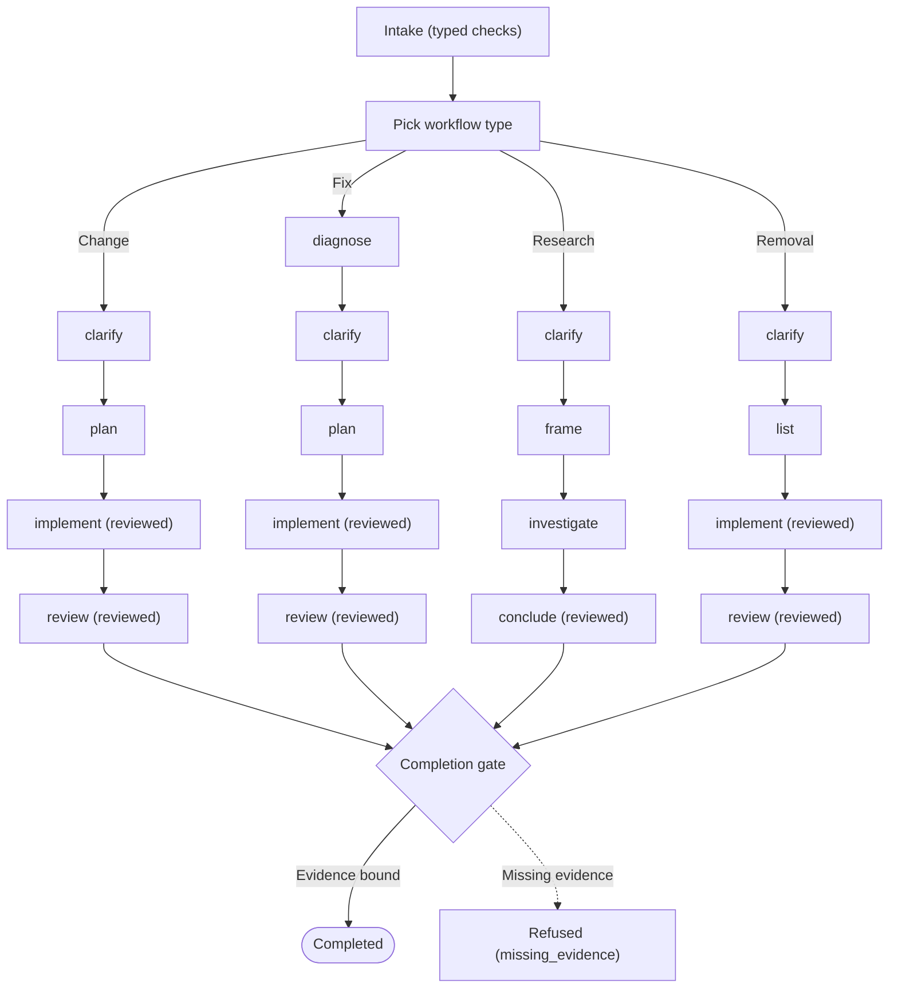
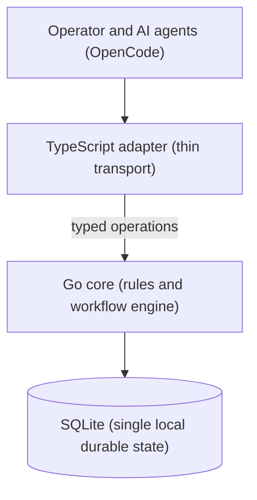

<picture>
  <source media="(prefers-color-scheme: dark)" srcset="brand/logos/concord-primary-mono-light.svg">
  
</picture>

# Concord

*Organized Product Development at Chaotic Speed.*

Concord is a local coordination engine for AI coding agents. It turns approved
goals, delegated work, and delivery evidence into a typed, durable workflow.
Operators coordinate multiple agents on one workstation; the engine gates
every state transition on verified evidence.

Concord models development as an evidence-gated state machine. It validates
intake, builds a typed step plan for each work item, coordinates concurrent
work across agents, and refuses completion until independent review and
verification evidence are recorded. Linear owns planning; Concord enforces
execution state locally.

[What's different](#whats-different) ·
[How it works](#how-it-works) ·
[Agents and helpers](#agents-and-helpers) ·
[Architecture](#architecture) ·
[Specialized graphs](#specialized-graphs) ·
[Engineering highlights](#engineering-highlights) ·
[Install](#install-and-setup) ·
[Key links](#key-links)

## What's different

Most agent frameworks guide models by adding instructions and checklists to
prompts. Prompts drift under context pressure: agents declare victory early,
wander outside assigned scope, and approve their own code. Concord enforces a
state machine outside the model's context window, requiring machine-checkable
evidence before any task advances. Work contracts lock goals and safety
boundaries before implementation begins, and every refusal returns a typed
failure naming the exact remedy. Everything runs locally against a single
workstation database with no cloud service, external account, or telemetry.

## How it works



Every work item begins at intake with typed checks that can proceed, mark the
work already handled, decline it, or split or merge it. Once intake passes, the
driving agent selects one of four workflow types: Change, Fix, Research, or
Removal. Concord copies the type's required steps from the [template contract](contracts/workflow-step-templates.v1.json)
into a per-item plan stored on the workflow record. Agents can insert
intermediate steps, keeping the plan a directed acyclic graph (DAG): a send-back
is a new step after the current one, never a backwards edge. Steps marked as
reviewed pass only with a recorded typed review — reviewer, result, commit, and
link. Terminal completion is refused with `missing_evidence` until every
required evidence binding stands.

The [terminal-gate integration test](internal/agent/trunk_firewall_test.go#L117-L163)
demonstrates this gate directly:

| Scenario | Agent action | Engine verdict |
|---|---|---|
| **Missing evidence** | Agent requests completion with no attached evidence | Refuses with `missing_evidence`. Prompt claims cannot satisfy the transition. |
| **Gated completion** | Agent submits valid verification evidence | The transition completes: the recorded evidence satisfies the terminal gate. |

Run this test from a source checkout:

```sh
bin/oc-test targeted -- go test ./internal/agent \
  -run '^TestMainCheckoutLifecyclePreservesTerminalGates$' -count=1 -v
```

## Agents and helpers

Concord ships with primary agent profiles for full sessions, specialized step
helpers for individual workflow steps, and read-only utilities:

| Role or helper | Workflow stage | Responsibility |
|---|---|---|
| `Concord` | End to end | Primary coordinator; drives one work item with the operator |
| `Concord-RTE` | Coordination | Optional; sequences multi-session dependencies |
| `Concord-Planner` | Intake and planning | Optional; structures requirements and backlog refinement |
| `concord-research` | Diagnose · frame · investigate | Investigates root causes and framed research questions |
| `concord-design` | Implement (visual slices) | Builds UI changes, wireframes, and versioned previews |
| `concord-implement` | Implement | Makes one bounded change; proves a Fix regression fails before the fix and passes after |
| `concord-verify` | Inserted test-only steps | Runs named local checks or diagnoses completed CI runs without editing files |
| `concord-review` | Review · conclude | Reviews implementation diffs and research conclusions against standards |
| `concord-explore` | Any step (read-only) | Explores repository structure and evidence paths |
| `concord-lookup` | Any step (read-only) | Researches external documentation and sources |
| `concord-advisor` | Any step (read-only) | Provides independent second opinions on bounded decisions |

The host's native Task tool owns delegation; Concord neither launches subagents
nor wraps their prompts or results. Specialized workflows and engineering
methods load on demand from the maintained [skills index](skills/README.md).

## Architecture



Concord separates responsibilities across three focused layers:

- **Single Go core for domain authority.** Go implements all workflow rules,
  admission checks, and state transitions to prevent rule drift between host
  plugins and the engine. The TypeScript adapter is a thin transport that
  passes host session context and tool invocations to the Go binary.
- **Single local database.** A local SQLite database holds all current
  execution state, effects, and bound evidence. It runs in WAL mode with
  `synchronous=NORMAL` for routine writes and switches to `synchronous=FULL`
  only for designated durable transactions, making durability costs explicit
  instead of paying full disk-flush guarantees on every write.
- **Decoupled planning and execution.** Linear owns issue planning and
  milestone tracking; Concord coordinates local execution. Agents interact
  with Linear via the Linear MCP server; Concord records at most one issue
  key and URL per work item, makes no Linear API call, and holds no Linear
  credential.

The trust boundary is the local workstation: the operating system user account,
the OpenCode process, and the adapter. Concord does not defend against arbitrary
code already running under that account. See the [transport contract](.concord/law/specs/agent-adapter-transport-contract.md),
[core architecture](.concord/docs/core-architecture.md), and
[managed development authority](.concord/law/specs/managed-development-authority.md).

## Specialized graphs

Complex agent workflows cannot fit into a single DAG without tangling
scheduling, execution recovery, and architectural authority. Concord isolates
four specialized graphs:

1. **Task coordination graph (`blocks`, `depends_on`).** Manages inter-task
   dependencies and parallel execution queues across agent sessions. Directed
   relations from the [relation vocabulary](contracts/relation-vocabulary.v1.json)
   filter ready tasks from the [ready queue](internal/store/query.go). When two
   concurrent items change the same product area, a recorded [overlap resolution](internal/store/workflow_domain_overlap.go)
   orders them with explicit dependency edges.
2. **Per-item step plans (execution DAG).** Real delivery needs retries,
   inserted diagnostic steps, and clarification that a fixed chain cannot
   express. Each work item copies its required steps from the [template contract](contracts/workflow-step-templates.v1.json)
   into a stored plan; inserted steps extend it forward, never backwards.
   Contracts lock goals before implementation and require operator approval
   for product direction, UI/UX, production application data, security,
   increased spending, and legal obligations. All plan mutations pass a single
   [plan validator](internal/store/workflow_step_plan.go) and [preflight check](internal/store/workflow_preflight.go).
3. **Architectural authority graph (Domains and Product law).** A registry
   partitions architectural rules across Domains (bounded areas of system
   responsibility). Each law record has one home Domain, and Domain relations
   declare boundary dependencies, shared contracts, and replacements. Relations
   between law records model refinement, subordination, and conflict. Inspect
   the committed [law-folder snapshot](internal/store/law_snapshot.go) and [boundary validation](internal/store/law_boundary.go).
4. **Provenance graph (evidence bindings).** Completion requires proof, not
   conversational assertions. [Evidence bindings](internal/store/workflow.go)
   tie immutable test results, review attestations, and execution watermarks to
   specific commits and producers. Concord refuses terminal completion requests
   until all required evidence bindings are durably recorded, separating
   evidence gathering from final acceptance evaluation.

## Engineering highlights

- **Authority enforced outside the prompt.** Registered-client policies
  restrict operations by capability, Product, Project, and agent scope. Workflow
  gates validate subjects, evidence bindings, and approval boundaries outside
  model inference. Inspect the [authorization checks](internal/agent/authority.go)
  and [authority refusal tests](internal/agent/authority_refusal_kind_test.go).
- **Current-state authority and explicit durability.** SQLite stores current
  state and unresolved-effect receipts rather than replaying historical event
  logs. The store uses `synchronous=FULL` only for designated durable
  transactions and `synchronous=NORMAL` for routine writes. Inspect the
  [transaction owner](internal/store/durable.go),
  [durability tests](internal/store/durable_test.go), and the
  [ten-process conformance harness](internal/store/conformance_test.go).
- **Recoverable installs and automated releases.** The [release workflow](.github/workflows/release.yml)
  builds Linux amd64 binaries with SPDX software bills of materials, checksums,
  and GitHub build provenance. The installer journals operations so interrupted
  runs recover cleanly without overwriting operator changes; see the
  [installer tests](scripts/test-installer.py) for process-death recovery across
  install, upgrade, and uninstall.

## Build and verify from source

Building Concord requires the Go toolchain pinned in [`go.mod`](go.mod). Testing
the TypeScript adapter also requires Bun.

Local tests run through [`bin/oc-test`](bin/oc-test), which tiers workloads to
give fast feedback without overloading the workstation. Full suite selection,
sharding, and CI requirements are documented in [`TESTING.md`](TESTING.md) and
[`.github/workflows/ci.yml`](.github/workflows/ci.yml).

### Quick checks

```sh
go run ./cmd/concord --version
bin/oc-test targeted -- python3 scripts/check-doc-links.py
bin/oc-test targeted -- python3 scripts/check-public-content.py
```

### Full package and adapter suites

```sh
bin/oc-test broad -- go test ./cmd/concord
bin/oc-test broad -- env -u CONCORD_SELECTED_PRODUCT_ID bun test adapter/opencode/
```

## Install and setup

Concord targets Linux amd64 and requires Python 3 for installation. Review the
[installation prerequisites](.concord/docs/installation.md#prerequisites) before
beginning.

### 1. Download and run the installer

Download `concord-installer.py` from the
[latest release](https://github.com/Sharper-Flow/concord/releases/latest) and
install the target release tag (replace `vX.Y.Z`):

```sh
python3 concord-installer.py install --version vX.Y.Z
```

The installer verifies the release checksum and archive before changing any
data, binary, adapter, or OpenCode configuration path. It journals file
operations to recover from interrupted installs and never overwrites
user-modified files. Release assets also carry GitHub build-provenance
attestations, which the installer does not check. Restart OpenCode after
installation completes.

> **Keyring notice for headless servers:** On a headless system without an
> existing desktop login collection, the installer initializes an unencrypted,
> user-scoped keyring collection protected by operating-system file permissions.

### 2. Authorize agent profiles

Before activating agent profiles (`Concord`, `Concord-RTE`, or optional
`Concord-Planner`), [authorize the primary agent names](adapter/opencode/README.md#authorize-the-primary-agent-names-before-activation)
on each trusted client. Installing profiles does not grant agent execution scope.

### 3. Bootstrap your project

Initialize the repository using the [operator bootstrap CLI](adapter/opencode/README.md#operator-bootstrap-cli):

1. **Register the client** (`concord client-register`): records the client's Ed25519 public key and capability and scope grants. The private key stays in the host credential service.
2. **Create the Product and Project** (`concord product-create`): establishes the coordination scope.
3. **Add a repository locator** (`concord project-locator-add`): binds the Project to a checkout path or Git remote.

Each bootstrap command reads a strict JSON payload from stdin and writes a
bounded JSON response to stdout:

```sh
concord --version
concord --help
```

Once bootstrapped, launch agent sessions through your host environment.
[Host tools own branch and worktree placement](.concord/law/decisions/CD-0088-host-owned-work-bootstrap-preserves-pre-readiness-authority.md#d1-host-tools-own-worktree-isolation).
Inside a session, use the published capture and workflow operations for Concord
state.

The [installation guide](.concord/docs/installation.md) covers artifact
verification, managed paths, repair, upgrade, and uninstall.

## Key links

- [Product vision](.concord/docs/product-vision.md)
- [Product law](.concord/law/)
- [Architecture reference](.concord/docs/core-architecture.md)
- [Documentation index](.concord/docs/README.md)
- [Installation guide](.concord/docs/installation.md)
- [OpenCode adapter guide](adapter/opencode/README.md)
- [Contribution guidance](CONTRIBUTING.md)

## Contributing

Read [CONTRIBUTING.md](CONTRIBUTING.md) before opening a pull request.

## Security

Report suspected vulnerabilities privately through GitHub Security Advisories,
not a public issue or pull request. Only the latest tagged release is supported
for security fixes. See [SECURITY.md](SECURITY.md).

## License

Concord is released under the [MIT License](LICENSE).
